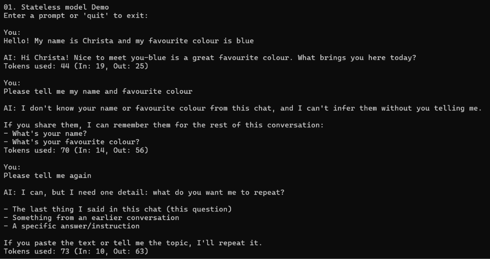
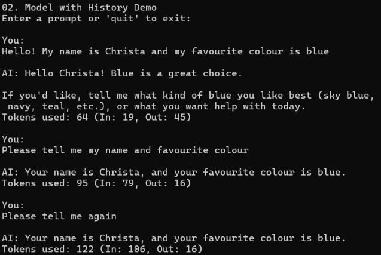

# Model

Links to source code of demos: 
- [StatelessModel/Program.cs](https://github.com/christapauliina/ai-configuration-examples/blob/master/01-StatelessModel/Program.cs)
- [ModelWithHistory/Program.cs](https://github.com/christapauliina/ai-configuration-examples/blob/master/02-ModelWithHistory/Program.cs)
## Memory

A model is simply an inference engine. It has no memory or access to external tools or knowledge. Because it is stateless, a raw model cannot hold a conversation on its own. Most systems include built-in application logic around the model to create an illusion of memory.

At its simplest, the application takes the prompts and answers, adds them to the conversation history, and sends the entire history back to the model every time there is a new request. To demonstrate this, the screenshots below show two terminal applications: one connecting directly to a stateless model, and another that maintains a conversation history around the model. 

### Raw model 

### Raw model with simple application layer memory

While the ability to hold a conversation is easy to spot, you might also notice that token consumption differed between the two demos: the model with application-layer memory consumed more and more tokens as the conversation progressed. In a short conversation like this, that is not an issue in terms of context window limits or pricing. However, in many real-world scenarios, you need to actively control context window utilization as simply appending the entire history indefinitely does not serve the end user.

When designing context window management, it is good to keep a few key heuristics in mind:

1. Most common models use only 10–20% of their context window efficiently.  
2. Models comprehend information best when it is placed at the beginning or at the end of the context.

Key methods for context window management at the application layer include limiting the length of the conversation history or providing the model with a summary of earlier conversations.

In relation to pricing, for example Claude Fable 5 (which is considered one of the top models for public use) has a 1 -million-token context window and is priced at $8 per million input tokens and $40 per million output tokens in standard API use. (November 20, 2026).

::: info Further reading
- [RULER: What's the Real Context Size of Your Long-Context Language Models? (Hsieh et al., 2024)](https://arxiv.org/abs/2404.06654)
- [Reasoning-in-a-Haystack / BABILong (Kuratov et al., 2024)](https://arxiv.org/abs/2406.10149)
- [Lost in the Middle: How Language Models Use Long Contexts (Liu et al., 2023)](https://arxiv.org/abs/2307.03172)
