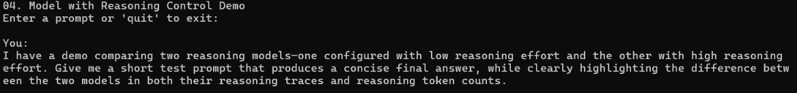
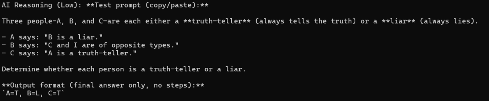
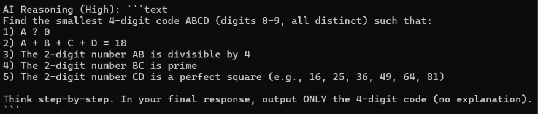
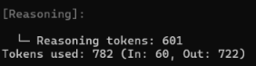
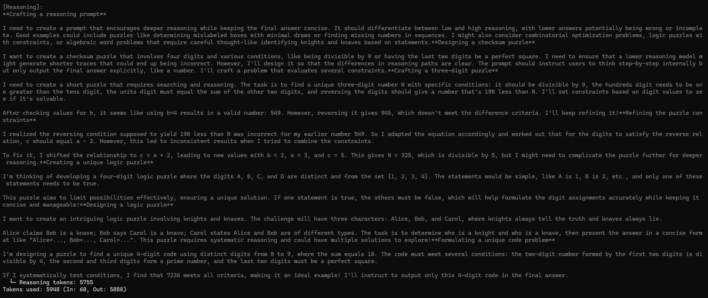

# Model

## Parameters

### Reasoning Effort

While modern LLMs are astoundingly powerful, many tasks do not require their full reasoning capacity. Although using the most complex reasoning patterns may lead to a better outcome, it also increases token consumption and costs. Below is a demonstration where a single model is given the same prompt, comparing its output, token consumption, and chain of thought at low and high reasoning effort.

#### The prompt

*I have a demo comparing two reasoning models—one configured with low reasoning effort and the other with high reasoning effort. Give me a short test prompt that produces a concise final answer, while clearly highlighting the difference between the two models in both their reasoning traces and reasoning token counts.*

#### Model with low reasoning response

#### Model with high reasoning response

Looking at the answers, both reasoning levels produced a similar idea and structure for the test prompt. However, when I actually tested the prompts they generated, the prompt suggested by the **low-reasoning** configuration created a **41% difference** in reasoning tokens between the two configurations, whereas the prompt suggested by the **high-reasoning** configuration created only a **24% difference**. In other words, for our original meta-prompt (shown above), the high-reasoning model actually produced a worse result.

Even though the outcome was worse, the gap in token consumption is huge. With the original prompt, the low-reasoning model used **601 reasoning tokens** and produced no chain-of-thought summary to print out (see below):

By comparison, the high-reasoning model used **5,755 reasoning tokens** and generated a lengthy chain-of-thought summary—essentially producing a weaker result at nearly **10x the token cost** (see below):

We can now confidently say that higher reasoning effort does not always produce a better outcome, though it is almost always slower and more expensive. Save high reasoning for tasks that require  multi-step logic, debugging, or planning under complex constraints as for straightforward or open-ended prompts, overthinking can actually degrade the result. When configuring reasoning efforts, consider how much effort your task actually needs and testing different settings against your real use cases. You can configure reasoning dynamically, for example increasing reasoning after a failed tool call. 

### Sampling & Generation Parameters

