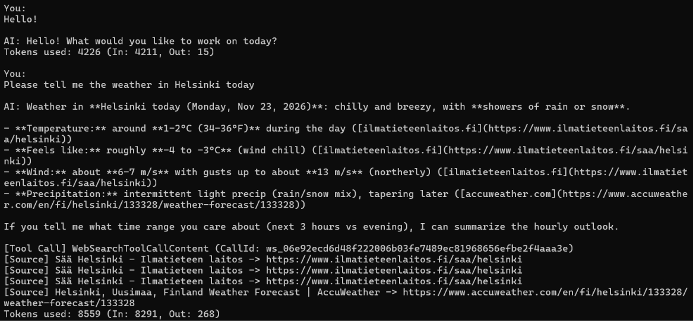
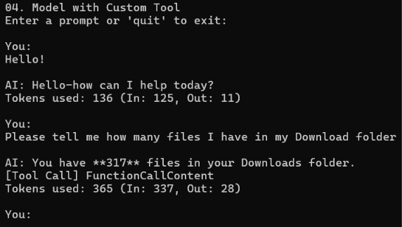

# Agent

Links to source code of demos: 
- [AgentWithBuiltInTool/Program.cs](https://github.com/christapauliina/ai-configuration-examples/blob/master/06-AgentWithBuiltInTool/Program.cs)
- [AgentWithCustomTool/Program.cs](https://github.com/christapauliina/ai-configuration-examples/blob/master/07-AgentWithCustomTool/Program.cs)

## Tools

Tools are an application-layer extension in LLM configuration that give a model capabilities beyond text generation through function calling. Rather than executing actions directly, the model outputs a structured request to invoke a tool, and the surrounding system executes it and returns the result.

While tool capabilities vary widely, common examples include web search, code interpreters, and file system access. Using tools requires native function-calling support from the model, which almost all modern LLMs provide.

Tools can be built-in (hosted); for example, Microsoft Foundry and OpenAI interfaces provide ready-to-use tools, such as Bing Grounding (searching the web) or Code Interpreter (running Python in a sandbox). When you use built-in tools, the tool call is executed in the provider's cloud. Alternatively, you can write your own custom tools that run in your own application environment.

Below is an demonstration for agent, that has been given a ability search the internet via Azures built-in web search.  Notice the token consumption. Tool definitions and results can add significant overhead to the input tokens. 

As shown above, tool usage is quite heavy on token consumption. Especially in this case, because this built-in tool injects a large internal system prompt, a multi-step browser schema, and additional metadata into every request.

When using application-layer memory, you should carefully consider how tool calls and their results are stored in the conversation history. If you do not save them at all, the agent may have to make redundant tool calls if the user asks follow-up questions about the first result. Conversely, if you save all tool call information indefinitely, your context window can bloat quickly, increasing the token consumption and at some point model's performance starts to decrease. One strategy is to delete old tool call and result pairs from the history after 2–4 turns have passed.

Below is a demonstration of using a custom tool. In this case, the custom tool counts the files in the local Downloads folder. With this tool, token consumption is much lower because the tool returns a single number rather than lengthy web content. Note that a custom tool's JSON schema is included in every API call throughout the conversation, even on turns when the tool isn't invoked.

