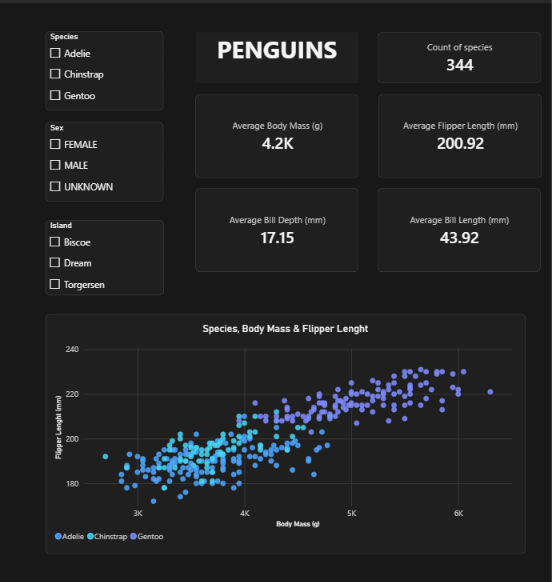
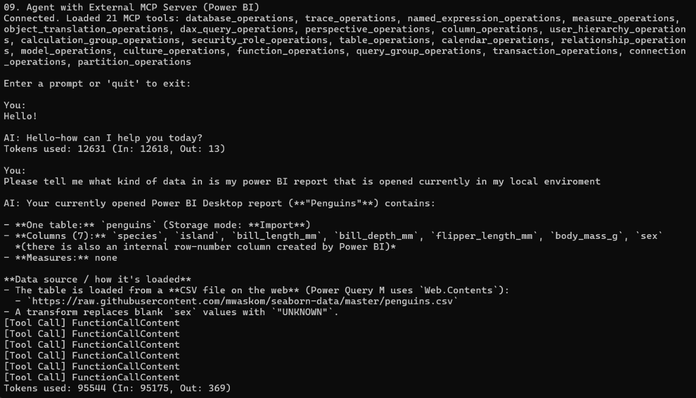
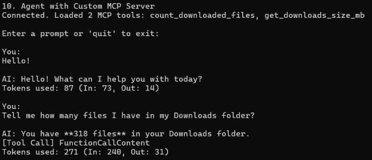

# Agent

Links to source code of demos: 
- [AgentWithExternalMCP/Program.cs](https://github.com/christapauliina/ai-configuration-examples/blob/master/08-AgentWithExternalMCP/Program.cs)
- [CustomMCP/Program.cs](https://github.com/christapauliina/ai-configuration-examples/blob/master/09-CustomMCP/Program.cs)
- [AgentWithCustomMCP/Program.cs](https://github.com/christapauliina/ai-configuration-examples/blob/master/10-AgentWithCustomMCP/Program.cs)

## MCP

In the previous section, we built a custom tool directly inside our application to count files in the local Downloads folder. Now imagine the application needs a full set of filesystem operations—finding, reading, and writing files—and you plan to build another application later that requires those exact same capabilities. Instead of duplicating tool implementations across every project, you can encapsulate them in an MCP (Model Context Protocol) server. MCP provides a standardized way for agents to access a toolset, making toolsets reusable across different applications.

In this section, we first connect our agent to the official Power BI MCP server to explore and query a Power BI model. This pre-built server handles the connection to the underlying data model and provides a comprehensive toolset for schema inspection and DAX execution out of the box. Later, we build our own lightweight MCP server to demonstrate how to expose custom tools with minimal token overhead.

### Using an external MCP

In the demonstration below, we are using [Microsoft's MCP for Power BI](https://github.com/microsoft/powerbi-modeling-mcp/releases). For this demo, we have a super simple Power BI report containing data on different species of penguins.

We connect to the report and query its contents through an agent using the MCP server:

Looking closely at the metrics, the token consumption reveals a significant overhead: a simple greeting without any tool calls consumes **12,631** tokens, as the MCP tool definitions alone occupy a large chunk of the context window before anything actually happens. When asking what data is in the report, the agent makes six different tool calls and consumes **95,544** tokens in total for a single interaction.

While pre-built MCP servers offer fast plug-and-play capabilities, they often come with a heavy token footprint. A general-purpose server like the Power BI Modeling MCP exposes dozens of tools for creating, modifying, and querying models, and every tool definition is sent with every request while multi-step discovery calls multiply the cost.

In many cases, it might be reasonable to explore more economical alternatives, such as building a focused custom MCP server. For a scenario like this, a much leaner architecture would be to provide the semantic model's TMDL schema directly as lightweight context and connect the agent to the underlying data source for a single query. 

If you do opt for a pre-built MCP server, consider configuring the application layer to optimize token consumption—for example, by filtering out intermediate tool call and result pairs from conversation memory, or by using a multi-agent orchestration where the specialized agent accessing the MCP is invoked only when necessary. 

### Creating and using a custom MCP 

### Creating and using a custom MCP

To see how a focused custom server compares, we build our own lightweight MCP server that exposes just two targeted tools for inspecting the local Downloads folder: one for counting visible files and another for calculating their total size. We then connect our agent to this local server and run a single query.

In this demonstration, the agent completes the task with a single tool call and a fraction of the token consumption seen with the external Power BI server. Greeting consumed 87 tokens and the interaction with tool call 271. Of course, the task and the underlying toolset are wildly different from the Power BI example, so the token counts are not directly comparable, but the underlying principle still holds.

Note that the MCP protocol itself does not reduce token usage. Exposing the exact same tools as local application functions or through an MCP server sends identical JSON schemas to the model. The token efficiency comes entirely from keeping the toolset small, focused, and tailored to the task.

