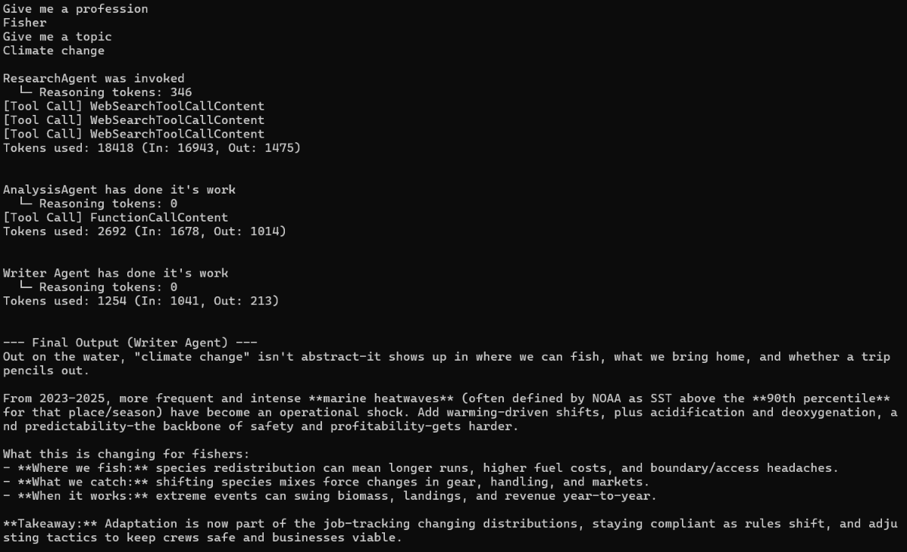

# Advanced

Link to source code of demo: [MultiAgentOrchestration/Program.cs](https://github.com/christapauliina/ai-configuration-examples/blob/master/11-MultiAgentOrchestration/Program.cs)

## Multi-Agent Orchestration

In the previous sections, we saw how an agent's context window fills up as conversation history, system prompts, tools, MCP schemas, and intermediate results accumulate. When a single generalist agent is expected to handle everything, the full weight of its configuration is loaded into every request. As responsibilities grow, this monolithic setup drives up token consumption, increases latency, and degrades reasoning quality.

One effective way to improve performance and control costs is to split the workload across specialized agents. In this section, we build a simple multi-agent orchestration consisting of a research agent, an analyst agent, and a producer agent. Below are the system prompt instructions defined for each agent. The research agent has web search configured as its tool and is itself wrapped as a tool that the analyst agent can invoke.

> **Analyst Agent Instructions:**  
> You are a critical technical analyst. Given a profession and a topic, use the `SearchFacts` tool to gather up-to-date information as needed, and produce a structured analysis covering:
> 1. Core role description for the profession
> 2. Current trends affecting the profession
> 3. Key points about the provided topic
> 4. How the topic relates to and impacts the profession

> **Writer Agent Instructions:**  
> You are a technical content producer. Take the provided analysis and write a crisp, engaging LinkedIn post (max 150 words) from the perspective of a representative of that profession about the given topic.
> - Include 3 bullet points and a clear takeaway.
> - Do not invent new facts beyond what is provided in the analysis.

> **Research Agent Instructions:**  
> You are a focused web researcher. Use web search to find accurate, up-to-date facts.  
> Return ONLY raw, concise bullet points with key facts and numbers. No intro or outro.

Breaking the system prompt into three simpler parts instead of one long, complex prompt produces more concise results and reduces token consumption. Although the token savings in a single demo run are minimal, system prompt token consumption can accumulate substantial costs over time in some implementations, such as high-traffic customer-facing chatbots.

Below is a screenshot from the demo application:

If the Analyst Agent had been given direct access to the web search tool in this demo, almost all of the 18,400 tokens used by the Research Agent would have ended up in the Analyst Agent's context window and message history. Passing that entire message history forward to the Writer Agent—or reusing the Analyst Agent in subsequent turns—would have increased token consumption significantly. Therefore, when orchestrating multiple agents, understanding how context windows and memory transfer between agents is essential for keeping token usage and costs under control. 

Ultimately, the main goal of multi-agent orchestration is to improve the quality of the final output and reduce the need for a human in the loop. When models are capable enough to handle specialized roles reliably, orchestrating agents allows workflows to operate more autonomously from start to finish.